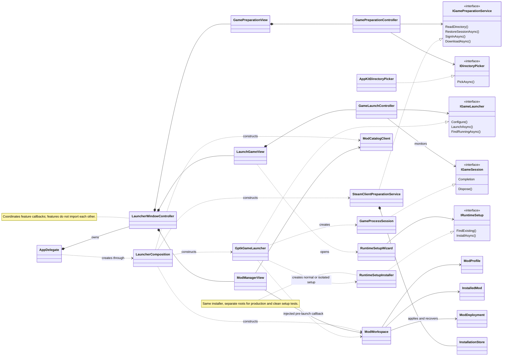

# DeadLocky

Deadlock launcher for Apple Silicon Macs, using .NET 10 and native AppKit on macOS 14 or later.
Release builds use NativeAOT; Debug builds keep the managed runtime for Rider debugging.

The **Emergency quit** button cancels pending launches, force-stops Windows Steam, Deadlock and Wine
in the configured prefix, then closes DeadLocky. Other Wine prefixes are left running.
Use it when the game or runtime is stuck; unsaved progress may be lost. If cleanup fails,
DeadLocky stays open, displays the error and allows another shutdown attempt. Starting new work
is disabled once emergency shutdown has been requested.

## Install the app

Open the Apple Silicon DMG, drag **DeadLocky.app** to **Applications**, eject the
image and open the installed copy. The app includes its native code; users do not
need .NET, Rider or Xcode. An ad hoc build is not notarized and macOS may block its
first launch; see [installation instructions](docs/Install.md).

For maintainers, `bash scripts/create-dmg.sh` builds and verifies the image plus a
SHA-256 checksum under `artifacts/Releases`. See [release instructions](docs/Releasing.md)
for checks, Developer ID signing and optional notarization.

## Set up and play

The setup wizard appears when no valid game environment exists. Download Apple's GPTK evaluation
environment from [Apple](https://developer.apple.com/games/game-porting-toolkit/) and select its DMG
or mounted volume. Apple's download and license acceptance remain user actions. The wizard imports
Apple graphics, downloads verified Wine components, prepares a dedicated prefix and installs Windows
Steam. If Rosetta is missing, the wizard offers installation with explicit license acceptance.

Sign in once in Windows Steam and enable Remember me. That same client handles download, updates
and play. The launcher reads saved login metadata locally; it does not store a second Steam token. **Manage Steam**
opens the client. Steam handles game updates when opened through **Manage Steam**
or **Play**. **Download** is shown only until the game is installed. **Change folder…** selects the installation
location; Command-O is its keyboard shortcut.
The default game location is `~/Games/Deadlock`.

**Play** tracks the actual game process. **Close Steam after Deadlock exits** is a saved preference;
when enabled, cleanup targets only the configured dedicated Wine prefix. Other Wine prefixes and
native Steam are not stopped. Keep DeadLocky open for monitoring and cleanup. Closing the launcher
detaches monitoring and leaves the game running. Wine's blocking crash dialog is disabled in the
configured prefix; this does not fix underlying game crashes.

macOS may ask for microphone access under **DeadLocky** when Deadlock initializes voice chat
or opens Settings. The request is attributed to the launcher because it starts Wine; choose whether
to allow access in the system dialog. The app bundle declares `NSMicrophoneUsageDescription` so macOS
can present that dialog. A missing purpose string caused a Settings hang on the development machine;
adding it and granting microphone access resolved the hang during local testing.

## Mod profiles and catalog

Open **Mods** to browse the public [deadlockmods.app catalog](https://deadlockmods.app).
Search names, authors and heroes; combine category and hero filters, change sorting, scroll the results
and move between pages. The last successful catalog is cached for offline browsing. Downloads require
an internet connection. NSFW entries are hidden unless explicitly included.

**Vanilla** is a permanent, read-only profile with no DeadLocky-managed mods. Create and rename custom
profiles, install a mod into the selected profile, enable or disable it, change its order, or remove it
from that profile. Other profiles retain their own installed versions and enabled state. Package files
are shared in the local cache. The selected profile is shown beside **Play** and is applied before launch;
profile edits are blocked while the game is running or starting.

Installation supports direct VPK files and ZIP, 7z and RAR archives through SharpCompress. Choose the
author's download and, for multi-variant archives, the VPKs you want together. Multipart data files are
included automatically. Required mod dependencies must already be enabled in the same profile.
Shared paths are allowed when their resource contents match. Texture comparisons ignore editor/compiler
provenance while preserving runtime blocks and pixel data; root package documentation does not conflict.
Panorama image lists (`panorama/image_compiler.vdata_c`) are combined across enabled mods, including their
external resource references. Only staged VPK copies are repacked; cached downloads stay unchanged.
Other different game content at the same path is reported as a conflict; disable one conflicting mod before Play.
A profile currently supports up to 99 enabled VPK indexes.

Mods are staged under `~/Library/Application Support/DeadLocky/Mods` and deployed only to
`game/citadel/DeadLockyAddons`. The launcher adds its own search path to the current `gameinfo.gi`, keeping the base
game's `Mod` and `Write` paths so default keybindings and settings remain available.
Returning to Vanilla removes the owned configuration entries and DeadLocky's files. Files installed by other tools are not
part of the clean-profile guarantee. A persisted transaction journal recovers interrupted deployments;
changed or foreign files block cleanup instead of being deleted. Current Steam metadata and the game
process are checked before game-file writes, and Steam configuration changes are preserved during recovery.
Catalog responses and previews are cached; no website account or Steam credentials are sent to the mod API.

## Architecture and checks

The UML class diagram below uses [Mermaid](https://mermaid.js.org/), an open source diagram renderer.
It is embedded directly in this README; no PlantUML tooling is required.



One application assembly uses PascalCase FSD directories:

- `App`: entry point, lifecycle, menu and composition.
- `Pages/Launcher`: screen layout and coordination between features.
- `Features/PrepareGame`: directory, saved Steam sign-in and installation workflow.
- `Features/LaunchGame`: environment setup, launch, process monitoring and exit cleanup.
- `Features/ManageMods`: catalog, downloads, profiles, VPK validation, deployment and recovery.
- `Entities`: game directory and Steam account values.
- `Shared`: reusable AppKit styles and directory-picker adapter.

Features do not import sibling features. The single application project targets `net10.0-macos` for AppKit
and `net10.0` for portable APIs and models. The xUnit project references its portable target directly. JSON persistence
uses source-generated serialization for NativeAOT.
There are no QRCoder or SteamKit2 dependencies, separate QR login, or custom Steam content downloader.
Installation receipts from earlier versions remain readable as a local fallback.

```sh
python3 scripts/check-fsd.py
.dotnet/dotnet test tests/DeadLocky.UnitTests/DeadLocky.UnitTests.csproj
.dotnet/dotnet format DeadLocky.slnx --verify-no-changes
```

[Architecture](docs/fsd-architecture.md),
[development route](docs/learning-route.md).
Build and unit checks do not establish game compatibility. A complete match, input, audio, graphics and
anti-cheat need validation against the actual macOS, Wine, GPTK and Deadlock versions. Successful play
has been reported on the development machine; fresh-install Steam sign-in and full-match coverage need
an end-to-end user check.

## Runtime ownership and sources

State lives under `~/Library/Application Support/DeadLocky`. Normal setup creates
`Runtime/ManagedWine11-r21/engine` and `Prefixes/Steam-Managed`. Existing configured environments remain
supported. Installations use a cross-process lock, staging, ownership markers and a readiness marker;
cancellation removes only new owned destinations. Verified downloads can be reused after interruption.
Images mounted by the wizard are detached; user-mounted volumes remain mounted.

Wine 11 r21 comes from [Highball](https://github.com/gauthierpiarrette/highball-engine).
Standalone Unix dependencies come
from [Gcenx](https://github.com/Gcenx/game-porting-toolkit/releases/tag/Game-Porting-Toolkit-3.0-3);
its Wine 7 DLLs are not copied over Wine 11. Steam comes from [Valve](https://store.steampowered.com/about/).
Apple graphics are supplied by the user under Apple's terms. Redistributing runtime components requires
review of their licenses; the launcher does not redistribute Apple's download.

## License

DeadLocky is [MIT-licensed](LICENSE). Dependency licenses and notices are included
in [ThirdPartyNotices.txt](docs/ThirdPartyNotices.txt) and in the app bundle.
Steam, Deadlock, GPTK, Wine and downloaded mods retain their own terms.
